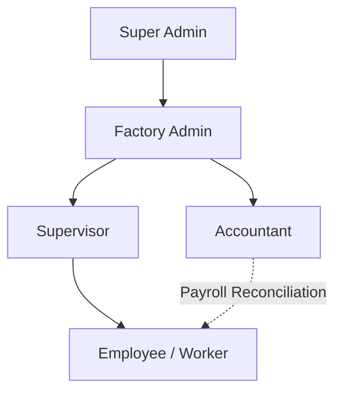
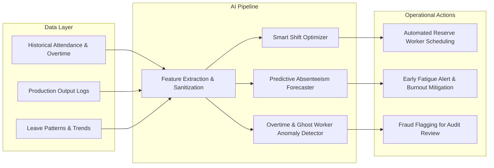
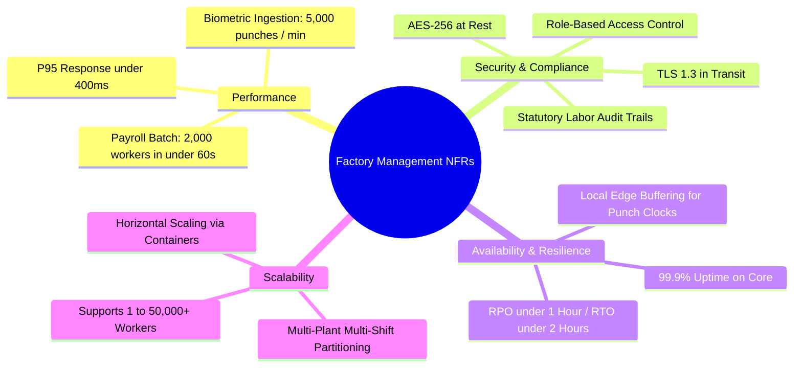
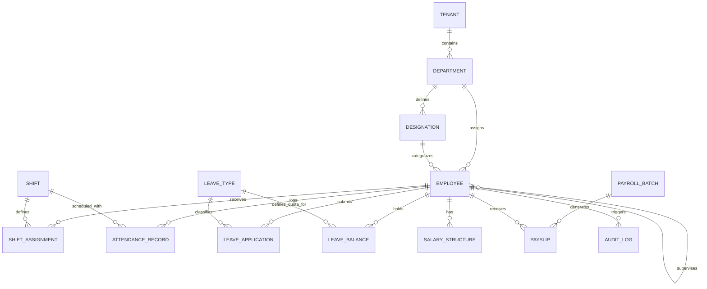
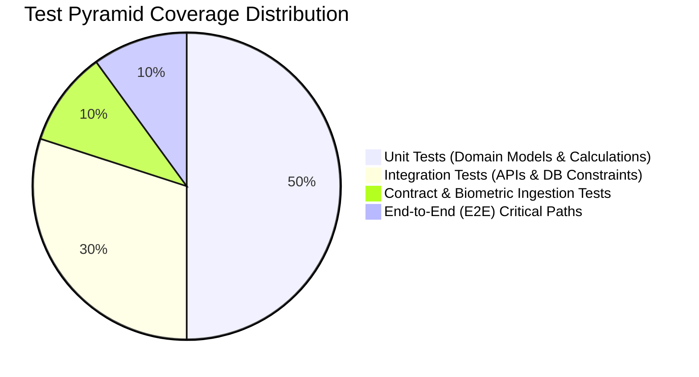
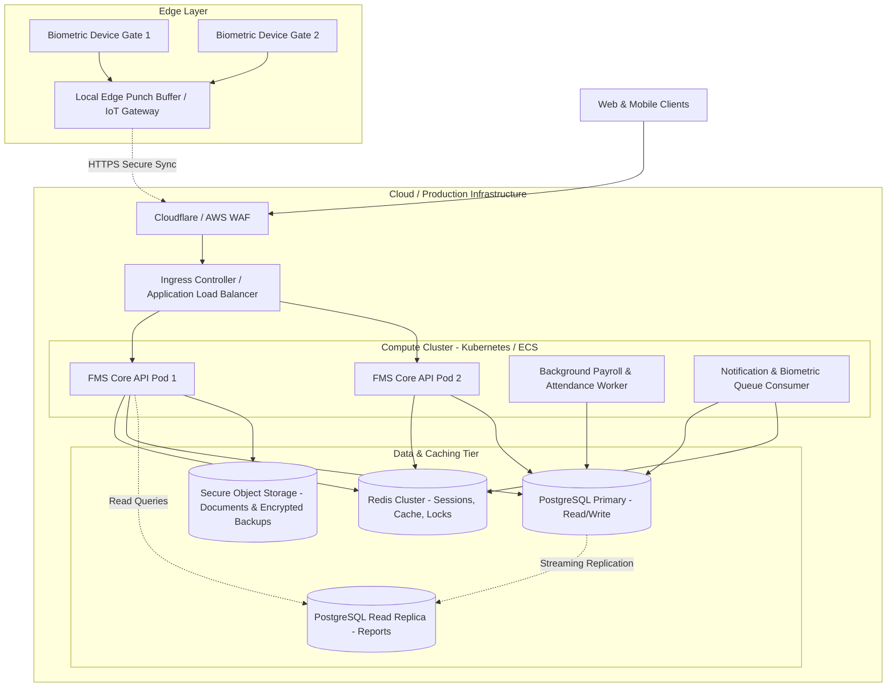

# Factory Management System (FMS)
## Business Requirements Document (BRD) & Software Architecture Specification
**Document Version:** 1.0.0-DRAFT  
**Target Domain:** Real-World Industrial Manufacturing & Workforce Operations  
**Authors:** Senior Business Analyst & Lead Software Architect  
**Status:** Requirements Baseline & Discovery Phase  

---

## Table of Contents
1. [Document Control & Requirements Classification](#1-document-control--requirements-classification)
2. [Business Problems & Strategic Objectives](#2-business-problems--strategic-objectives)
3. [User Roles, Personas & Permission Matrix (RBAC)](#3-user-roles-personas--permission-matrix-rbac)
4. [Modular Functional Specifications](#4-modular-functional-specifications)
   - 4.1. [Department & Designation Management](#41-department--designation-management)
   - 4.2. [Employee Lifecycle Management](#42-employee-lifecycle-management)
   - 4.3. [Shift & Attendance Management](#43-shift--attendance-management)
   - 4.4. [Leave Management & Approval Workflows](#44-leave-management--approval-workflows)
   - 4.5. [Compensation, Overtime & Payroll Engine](#45-compensation-overtime--payroll-engine)
   - 4.6. [Reporting, Business Intelligence & Dashboards](#46-reporting-business-intelligence--dashboards)
   - 4.7. [Notification Engine & Alerts](#47-notification-engine--alerts)
   - 4.8. [Future AI/ML Automation Opportunities](#48-future-aiml-automation-opportunities)
5. [Cross-Cutting Functional & Non-Functional Requirements (NFRs)](#5-cross-cutting-functional--non-functional-requirements-nfrs)
6. [Data Model, Entities & Relational Architecture](#6-data-model-entities--relational-architecture)
7. [Authentication, Authorization & Security Architecture](#7-authentication-authorization--security-architecture)
8. [Validation Rules, Edge Cases & Error Handling](#8-validation-rules-edge-cases--error-handling)
9. [Auditability, Compliance, Backup & Disaster Recovery](#9-auditability-compliance-backup--disaster-recovery)
10. [Testing, Quality Assurance & Deployment Topology](#10-testing-quality-assurance--deployment-topology)
11. [Discovery Questionnaire & Missing Information Checklist](#11-discovery-questionnaire--missing-information-checklist)

---

## 1. Document Control & Requirements Classification

To ensure strict engineering governance and prevent unauthorized or fictitious business rules from entering development, all requirements in this specification are partitioned into two strict categories:

### 1.1 Confirmed Core Requirements (Scope Mandates)
* Multi-tenant or multi-tier enterprise role hierarchy: **Super Admin**, **Factory Admin**, **Supervisor**, **Accountant**, and **Employee**.
* Complete workforce lifecycle tracking across dynamic departments, production lines, and hierarchical designations.
* Real-world industrial attendance capture with multi-shift scheduling (including rotational and overnight shifts).
* Configurable leave management with policy enforcement, quota tracking, and multi-step approval workflows.
* Industrial-grade payroll engine supporting fixed, hourly, piece-rate, or daily-wage workers, progressive overtime calculations, deductions, bonuses, and statutory compliance.
* Monthly executive and departmental reporting, historical audit logs, and actionable dashboards.
* Decoupled notification dispatch system with extensible architecture for subsequent AI/ML pipeline integration.

### 1.2 Baseline Assumptions (Requiring Factory Sign-off Prior to Code Implementation)
* **Working Calendar:** A standard 6-day or 5-day industrial workweek depending on production floor vs. administrative staff.
* **Attendance Device Integration:** Hardware-agnostic ingestion supporting biometric punch logs (ZKTeco/eSSL), RFID smart cards, or supervisor-assisted manual punch overrides.
* **Overtime Standard:** Daily threshold basis (e.g., >8 hours/shift) and/or weekly threshold basis (e.g., >48 hours/week), calculated at a standard multiplier (e.g., 1.5x or 2.0x base wage) subject to local labor laws.
* **Currency & Fiscal Units:** Multi-currency ready, defaulted to the factory's primary operating domestic currency.
* **Data Jurisdiction & Hosting:** On-premise local server deployment or secure private cloud within regional sovereignty boundaries.

---

## 2. Business Problems & Strategic Objectives

### 2.1 Core Real-World Factory Challenges
1. **Time Theft & Inaccurate Attendance:** Manual punch cards and unsupervised paper registers lead to "buddy punching", inaccurate shift logs, and inflated labor costs.
2. **Shift Scheduling Bottlenecks:** Production lines stall when dynamic absenteeism is discovered late, causing line imbalances between machine operators, helpers, and quality inspectors.
3. **Payroll Discrepancies & Worker Discontent:** Manual calculations of complex industrial wage structures (overtime, night differential, production bonuses, statutory provident funds, tax withholdings) lead to payroll delays, union grievances, and compliance fines.
4. **Information Silos:** Factory management lacks consolidated real-time operational visibility into absenteeism rates, labor cost per production unit, and department headcounts.
5. **Lack of Audit Trails:** Arbitrary salary revisions, unauthorized shift swaps, and unmonitored leave approvals create vulnerability to internal fraud and failure during statutory labor audits.

### 2.2 Measurable Strategic Objectives (KPI Targets)
* **Payroll Processing Latency:** Reduce end-of-month payroll computation time from 5 business days to < 2 hours with automated batch processing.
* **Attendance Accuracy:** 99.9% reconciliation between physical plant floor entry/exit logs and system timesheets.
* **Operational Visibility:** Real-time dashboard updates displaying line-level staffing status within 15 minutes of shift commencement.
* **Compliance & Audit Readiness:** 100% automated traceability on every profile modification, overtime approval, wage adjustment, and payout disbursement.

---

## 3. User Roles, Personas & Permission Matrix (RBAC)

The system enforces strict Role-Based Access Control (RBAC). No user may escalate privileges horizontally or vertically without explicit authorization.



### 3.1 Role Profiles

| Role | Persona Summary | Core Responsibilities |
| :--- | :--- | :--- |
| **Super Admin** | Platform Owner / Group IT Executive | System tenant configuration, global security policies, role assignment, system health monitoring, database backup/restore orchestration. |
| **Factory Admin** | Plant General Manager / HR Director | Department/designation setup, factory operational calendar, master employee onboarding/offboarding, shift templates, company-wide leave policies. |
| **Supervisor** | Shop-Floor Lead / Production Line Manager | Shift roster allocation, daily attendance verification, manual punch correction requests, first-level leave approval, overtime authorization. |
| **Accountant** | Chief Financial Officer / Payroll Officer | Compensation master data, deduction/allowance definitions, payroll generation, bank disbursement files, tax/statutory reporting. |
| **Employee** | Machine Operator / Floor Worker / Staff | Self-service portal: Punch review, leave requests, payslip download, personal profile overview, internal broadcast announcements. |

### 3.2 Granular RBAC Permissions Matrix

| Functional Capability | Super Admin | Factory Admin | Supervisor | Accountant | Employee |
| :--- | :---: | :---: | :---: | :---: | :---: |
| **System Settings & Tenant Config** | **CRUD** | View Only | None | None | None |
| **Audit Logs & Security Traces** | **Full Access** | View Only | None | None | None |
| **Department & Designation Setup** | **CRUD** | **CRUD** | Read Only | Read Only | Read Only |
| **Employee Master Record (Create/Edit)** | **CRUD** | **CRUD** | Read (Subordinates) | Read Only | Self Only |
| **Shift Definition & Scheduling** | **CRUD** | **CRUD** | Manage Allocated | Read Only | Read (Self) |
| **Attendance Capture & Verification** | **Full** | **Full** | Mark/Approve (Team) | Read Only | Punch/Self View |
| **Leave Policy Configuration** | **CRUD** | **CRUD** | None | None | None |
| **Leave Approval / Rejection** | **Full** | Final Override | First-Level (Team) | None | Apply/Cancel |
| **Salary Structure & Bonus Rules** | **CRUD** | Manage | None | **CRUD** | None |
| **Payroll Batch Execution & Lock** | **Full** | Approve | None | **Execute/Draft** | None |
| **Payslip Access** | View All | View All | None | View All | **Self Only** |
| **Financial & Labor Cost Reports** | **Full** | **Full** | Production Ops Only | **Full** | None |

---

## 4. Modular Functional Specifications

Each module is specified with formal systems-engineering rigor: Purpose, Users, Inputs, Outputs, Business Rules, and Dependencies.

---

### 4.1 Department & Designation Management

#### 4.1.1 Purpose
Establishes the structural backbone and functional hierarchy of the factory enterprise. Groups personnel logically by operating divisions (e.g., Spinning, Weaving, Dyeing, Quality Control, Warehouse, Maintenance, Administration) and standardizes pay bands, job titles, and reporting lines.

#### 4.1.2 Target Users
* **Primary:** Factory Admin, HR Manager.
* **Secondary:** Super Admin (system auditing), Accountant (cost center allocation).

#### 4.1.3 Inputs
* Department: Name, Code (e.g., `DEPT-PROD-01`), Cost Center Code, Department Head (Employee ID), Parent Department (for hierarchical trees), Operating Status (Active/Inactive).
* Designation: Title (e.g., Senior CNC Operator), Code, Job Grade/Band, Minimum & Maximum Base Wage Scale, Department Mapping.

#### 4.1.4 Outputs
* Organizational Hierarchy Tree (Interactive tree view & exportable structure).
* Cost center mapping reports for accounting integrations.
* Real-time active headcount tally per department and designation.

#### 4.1.5 Business Rules
1. **Unique Identifiers:** Department Codes and Designation Codes must be globally unique within the factory tenant.
2. **Soft Deletion & Referencing:** A Department or Designation cannot be hard-deleted if there are active employees currently assigned to it. It may only be marked `Inactive` or archived after reassignment of all personnel.
3. **Circular Reference Prevention:** A department cannot be designated as its own parent or a descendant of its child department.
4. **Default Cost Center:** Every department must link to exactly one valid accounting Cost Center for labor expense allocation.

#### 4.1.6 Module Dependencies
* **Upstream:** None (Core foundational master data).
* **Downstream:** Employee Management, Shift Scheduling, Payroll, Role-Based Access Control.

---

### 4.2 Employee Lifecycle Management

#### 4.2.1 Purpose
Governs the end-to-end lifecycle of factory workers and administrative staff: onboarding, personal/family identity verification (KYC/National ID), contract classification, statutory documentation, document storage, role progression, disciplinary tracking, and offboarding/settlement.

#### 4.2.2 Target Users
* **Primary:** Factory Admin / HR Department.
* **Secondary:** Supervisor (subordinate directory), Accountant (banking & tax details), Employee (self profile).

#### 4.2.3 Inputs
* **Demographics:** Full Name, Date of Birth, Gender, Blood Group, Marital Status, Emergency Contact Details.
* **Identification & Compliance:** National Identity Number (SSN/Aadhaar/NID), Tax Registration ID, Passport/Visa (where applicable), Biometric Device Identifier (Device User ID).
* **Employment Terms:** Employee ID / Badge Number, Date of Joining, Employment Type (`Permanent`, `Probationary`, `Contractual`, `Daily Wage`, `Piece-Rate`), Department ID, Designation ID, Direct Reporting Manager (Supervisor ID), Work Location / Plant Floor Section.
* **Banking & Financials:** Bank Name, Branch, Account Number, Routing/IFSC/IBAN Code, Payment Mode (`Bank Transfer`, `Cheque`, `Cash`).
* **Documents:** Uploaded scans of contract, government ID, medical clearance, trade certificates.

#### 4.2.4 Outputs
* Standardized Employee Profile Record & Digital ID Card / Badge generation.
* Onboarding checklist verification certificate.
* Exit clearance record and Full & Final (F&F) settlement trigger.
* Employee turnover and headcount fluctuation reports.

#### 4.2.5 Business Rules
1. **Unique Employee Identifier:** Employee ID and Biometric Device User ID must be strictly unique across active and archived records.
2. **Age Compliance:** Date of Birth must validate that the worker is of legal working age (e.g., $\ge 18$ years old) at the Date of Joining. The system must reject under-age entries unconditionally.
3. **State Machine Lifecycle:** Worker status must follow a strict finite state machine:
   $$\text{Draft} \longrightarrow \text{Active} \longrightarrow \text{Probation} \longleftrightarrow \text{Suspended} \longrightarrow \text{Notice Period} \longrightarrow \text{Terminated} / \text{Resigned} \longrightarrow \text{Archived}$$
4. **Segregation of Sensitive Data:** Bank account numbers, national IDs, and compensation details must be encrypted at rest and accessible only by authorized HR and Payroll personnel.
5. **Supervisor Hierarchy:** An employee cannot report to themselves or to an employee below them in the managerial tree.

#### 4.2.6 Module Dependencies
* **Upstream:** Department & Designation Management.
* **Downstream:** Attendance, Leave, Payroll, Notifications, RBAC Security.

---

### 4.3 Shift & Attendance Management

#### 4.3.1 Purpose
Captures, normalizes, and validates physical floor attendance across complex multi-shift factory operations. Bridges biometric hardware punch streams with automated time-tracking, handling night differentials, grace periods, meal breaks, and overtime pre-computations.

#### 4.3.2 Target Users
* **Primary:** Supervisor, Factory Admin.
* **Secondary:** Employee (clock-in logs), Accountant (payroll inputs).

#### 4.3.3 Inputs
* **Shift Configuration:** Shift Name (e.g., Morning Shift A, General Admin, Night Shift C), Shift Code, Start Time, End Time, Grace Period for Late In (e.g., 15 mins), Early Exit Threshold, Break Duration (paid vs. unpaid), Overnight Flag (`is_overnight = true/false`), Minimum Hours for Half-Day and Full-Day credit.
* **Roster Schedules:** Assigning employees/departments to shifts on a fixed, weekly, or rotational frequency.
* **Attendance Logs:** Timestamped punch events (`Device ID`, `User ID`, `Timestamp`, `Verification Method: Fingerprint / Face / RFID / Pin`).
* **Manual Correction Requests:** Supervisor adjustment with reason code (e.g., "Device Offline", "Off-site Plant Maintenance").

#### 4.3.4 Outputs
* Daily Attendance Timesheet (Present, Absent, Late In, Early Out, Half Day, On Leave, Holiday, Weekly Off).
* Auto-calculated Raw Working Hours, Net Working Hours, and Overtime Hours.
* Real-time Missing Punch and Shift Absence exceptions alerts.
* Standardized monthly consolidated attendance matrix for payroll consumption.

#### 4.3.5 Business Rules
1. **Midnight-Crossing Shift Logic:** For shifts marked `is_overnight` (e.g., 22:00 to 06:00 next morning), all punches must be credited to the shift origin date to prevent duplicate daily splits or broken hours calculations.
2. **De-duplication / Anti-Passback Buffer:** Successive punch logs from the same employee within an adjustable debounce interval (e.g., 3 minutes) must be discarded to prevent multi-tap corruption.
3. **Late-In / Early-Out Rules:**
   - Punch within Grace Period: Status = `Present (On Time)`.
   - Punch after Grace Period but within Late Threshold: Status = `Present (Late)`. Cumulative late arrivals (e.g., 3 lates in a month) can trigger automated half-day deductions based on policy switch.
   - Total hours $< \text{Half-Day Minimum}$: Status = `Absent`.
   - $\text{Half-Day Minimum} \le \text{Total hours} < \text{Full-Day Minimum}$: Status = `Half-Day`.
4. **Approval for Manual Overrides:** Any manual entry or correction performed by a supervisor must require mandatory audit notes and secondary approval by Factory Admin.

#### 4.3.6 Module Dependencies
* **Upstream:** Employee Lifecycle Management, Department Management.
* **Downstream:** Leave Management, Payroll Engine, Real-time Dashboard, Audit Trails.

---

### 4.4 Leave Management & Approval Workflows

#### 4.4.1 Purpose
Standardizes paid, unpaid, and statutory leave policies, automates annual quota accruals, and drives transparent multi-tiered approval workflows while preventing production line under-staffing.

#### 4.4.2 Target Users
* **Primary:** Employee (applicant), Supervisor (recommender/approver), Factory Admin (policy administrator/final approver).
* **Secondary:** Accountant (unpaid leave deductions for payroll).

#### 4.4.3 Inputs
* **Leave Type Setup:** Type Name (e.g., Casual Leave, Earned/Annual Leave, Sick Leave, Maternity/Paternity, Loss of Pay), Quota per Year, Accrual Frequency (Annual lump-sum vs. Monthly accrual), Carry-Forward Limit, Encashment Eligibility, Minimum Notice Period, Medical Document Requirement.
* **Leave Application:** Employee ID, Leave Type ID, Start Date, End Date, Half-Day vs. Full-Day indicator, Reason, Document Attachment (if medical).

#### 4.4.4 Outputs
* Real-time Individual Leave Balance Ledger (Accrued, Consumed, Pending Approval, Balance).
* Automated Leave Status Notifications (Approved, Rejected, Cancelled).
* Departmental Absence Calendar view for supervisors.
* Loss of Pay (LOP) / Leave Without Pay (LWOP) summary fed directly to payroll.

#### 4.4.5 Business Rules
1. **Negative Balance Restriction:** An employee cannot apply for paid leave exceeding their current accrued balance unless an explicit "Advance Leave" flag is authorized by Factory Admin.
2. **Consecutive Days & Sandwich Rule:** A configurable policy switch must enforce or waive the industrial "Sandwich Rule" (if an employee takes leave on Friday and Monday, the intervening weekend/holiday is counted as leave days).
3. **Department Staffing Quota Threshold:** If leave applications for a specific department/shift exceed a critical percentage of active personnel (e.g., $>15\%$ of machine operators on Shift A), the supervisor is flagged with a "Critical Staffing Deficit" warning.
4. **Immutable History on Closure:** Once a payroll month is locked and processed, approved leave records falling in that period cannot be revoked, altered, or backdated.

#### 4.4.6 Module Dependencies
* **Upstream:** Employee Lifecycle, Factory Operating Calendar.
* **Downstream:** Shift & Attendance Management, Payroll Engine.

---

### 4.5 Compensation, Overtime & Payroll Engine

#### 4.5.1 Purpose
Executes precise, transparent, and auditable wage computations for diverse factory employment types. Translates validated attendance, approved overtime, dynamic piece-rate units, bonuses, and statutory deductions into regulatory-compliant payslips and bank payout files.

#### 4.5.2 Target Users
* **Primary:** Accountant (computes, reconciles, executes), Factory Admin (reviews, approves & locks).
* **Secondary:** Employee (views & downloads payslips), Super Admin (financial audits).

#### 4.5.3 Inputs
* **Salary Structure Elements:**
  - *Earnings:* Base Salary / Basic Wage, House Rent Allowance (HRA), Conveyance, Production Incentive, Attendance Bonus, Night Shift Differential.
  - *Deductions:* Statutory Employee Provident Fund / Social Security, Professional Tax, Income Tax Withholding (TDS), Employee State Insurance (ESI), Loan/Advance Recovery, Canteen/Transport deductions.
* **Operational Inputs from Modules:**
  - Payable Days = $(\text{Total Calendar Days} - \text{LOP Days} - \text{Unexcused Absent Days})$.
  - Verified Overtime Hours (from Attendance Engine).
  - Piece-Rate Production Log counts (from Production Floor Logs, where applicable).
* **Ad-hoc Adjustments:** One-time bonuses, festival advances, damage penalties (with mandatory notes).

#### 4.5.4 Outputs
* Comprehensive Monthly Payroll Register (Pre-lock Draft & Post-lock Final).
* Digital Itemized Payslips (PDF with breakdown of earnings, deductions, gross, and net pay).
* Bank Electronic Fund Transfer (EFT) batch file (format tailored to corporate bank specs).
* Statutory Tax and Social Contribution summary reports.

#### 4.5.5 Business Rules
1. **Mathematical Invariant:** Net Salary must strictly obey the identity:
   $$\text{Gross Earnings} = \text{Base Wages (prorated)} + \text{Allowances} + \text{Overtime Pay} + \text{Incentives}$$
   $$\text{Total Deductions} = \text{Statutory Deductions} + \text{Taxes} + \text{Advances} + \text{Disciplinary Penalties}$$
   $$\text{Net Salary} = \text{Gross Earnings} - \text{Total Deductions}$$
2. **Non-Negative Pay Guardrail:** Net pay cannot evaluate to a negative number. If deductions exceed earnings (e.g., heavy advance recovery), the system must cap deductions at an allowable threshold and roll over remaining debt to the next month's ledger.
3. **Overtime Wage Formula:** Standard industrial formula baseline (customizable per labor jurisdiction):
   $$\text{Hourly Wage} = \frac{\text{Basic Salary} + \text{Fixed Allowances}}{\text{Standard Monthly Working Hours}}$$
   $$\text{OT Pay} = \text{Approved OT Hours} \times (\text{Hourly Wage} \times \text{OT Multiplier})$$
4. **Payroll Freezing / Locking:** Once the Factory Admin approves the monthly payroll run:
   - All associated attendance records, approved leaves, and overtime hours are permanently **locked**.
   - No retroactive modifications may be made to that cycle. Any subsequent retroactive adjustment must be disbursed as an "Arrear" in the subsequent pay cycle.

#### 4.5.6 Module Dependencies
* **Upstream:** Employee Master, Shift & Attendance Engine, Leave Management.
* **Downstream:** Financial Reporting, Payslip Self-Service, Banking Gateway.

---

### 4.6 Reporting, Business Intelligence & Dashboards

#### 4.6.1 Purpose
Transforms raw transactional data into actionable operational and executive intelligence. Provides immediate shop-floor visibility to supervisors while delivering cost trends, labor productivity, and compliance metrics to executive leadership.

#### 4.6.2 Target Users
* **Super Admin & Factory Admin:** Executive Dashboards, Cost Summaries, Headcount Trends.
* **Supervisor:** Shop-Floor Live Board, Daily Attendance & Absenteeism, Line Staffing Ratios.
* **Accountant:** Payroll Summaries, Overtime Payout Distribution, Tax & Statutory Audit Reports.

#### 4.6.3 Inputs
* Filter criteria: Date ranges, Department, Shift, Designation, Cost Center, Employment Type, Status.
* System events: Aggregated attendance timestamps, payroll registers, leave ledgers.

#### 4.6.4 Outputs
* **Executive Dashboard:** Live workforce headcount, today's absenteeism rate (%), ongoing shift labor cost, monthly OT run-rate.
* **Shop-Floor Live View:** Active workers on the line right now vs. expected capacity.
* **Exportable Reports:** Export to Excel (.xlsx), CSV, and PDF for:
  - Monthly Master Attendance Register (Form D / Form 25 compliance).
  - Monthly Overtime Register with supervisor approval traces.
  - Master Salary Register with cost-center breakdown.
  - Attrition & Retention Report.

#### 4.6.5 Business Rules
1. **Role-Scoped Aggregation:** Supervisors can never view salary, hourly rates, or financial compensation metrics in any report. Their analytics are restricted to operational metrics (hours, heads, attendance, line coverage).
2. **Asynchronous Generation for Heavy Datasets:** Reports spanning $>10,000$ transactional rows or multi-month historical scans must be processed asynchronously via background job queues to prevent UI thread starvation.

#### 4.6.6 Module Dependencies
* **Upstream:** All functional modules.
* **Downstream:** External BI tools (via secure API exports), Scheduled PDF/Email dispatchers.

---

### 4.7 Notification Engine & Alerts

#### 4.7.1 Purpose
Ensures rapid, event-driven communication across factory operations. Notifies workers of shift allocations and payslip releases, alerts supervisors to unexcused absences, and escalates pending leave or payroll approvals before deadlines.

#### 4.7.2 Target Users
* All system roles across their respective event triggers.

#### 4.7.3 Inputs
* Event Triggers:
  - *Attendance:* Unexcused absence after shift grace period, missing punch out, consecutive late entries.
  - *Leave:* New application submitted, request approved/rejected, emergency cancellation.
  - *Payroll:* Monthly payslip generated, salary disbursed, payroll batch awaiting approval.
  - *System:* User account locked, security anomaly detected, automated backup status.

#### 4.7.4 Outputs
* In-app Notification Feed (Bell icon with unread counts).
* Automated Email Notifications (HTML templates for desktop staff).
* SMS / WhatsApp Gateway Alerts (for shop-floor workers without active email accounts).

#### 4.7.5 Business Rules
1. **Worker Communication Fallback:** For shop-floor personnel lacking corporate email, critical alerts (shift changes, emergency plant notices) must route to SMS / WhatsApp or be surfaced on the supervisor's morning line-up tablet.
2. **Rate Limiting & Digesting:** To avoid notification fatigue, high-frequency alerts (e.g., bulk late arrivals) must be grouped into a single supervisor digest every 30 minutes.

#### 4.7.6 Module Dependencies
* **Upstream:** Attendance, Leave, Payroll, Security modules.
* **Downstream:** Third-party Communication APIs (Twilio, SendGrid, WhatsApp Business API).

---

### 4.8 Future AI/ML Automation Opportunities

To ensure the architecture is forward-compatible, the system schema and integration layers are prepared for subsequent predictive models:



1. **Smart Shift & Roster Optimization:** Machine learning models that ingest seasonal production order volumes and historical worker skill ratings to suggest optimal shift rosters, minimizing line downtime and premium overtime expenses.
2. **Predictive Absenteeism & Fatigue Forecasting:** Early-warning models that analyze historical seasonal patterns, weather conditions, festival calendars, and continuous overtime loads to predict Monday/post-payday absenteeism spikes, alerting supervisors to schedule reserve staff in advance.
3. **Automated Anomaly & Fraud Detection (Ghost Workers):** Statistical clustering models that continuously flag irregular biometric punch patterns, sudden spikes in manual overrides by specific supervisors, or uncharacteristic overtime distributions before payroll lock.

---

## 5. Cross-Cutting Functional & Non-Functional Requirements (NFRs)

### 5.1 Non-Functional Requirements (NFRs)



#### 5.1.1 Performance & Throughput
* **Interactive UI Latency:** 95% of standard transactional web requests (page loads, profile queries, leave requests) must respond in $\le 400\text{ ms}$.
* **Biometric Ingestion Throughput:** The punch ingestion webhook/queue must handle up to $5,000\text{ punches/minute}$ during peak shift changeover periods (15 minutes before and after shift start) without dropping packets.
* **Payroll Processing Engine:** The payroll calculation engine must process a factory workforce of 2,000 employees with complex wage structures in $< 60\text{ seconds}$.

#### 5.1.2 High Availability & Disaster Resilience
* **Service Availability:** The core system must maintain $\ge 99.9\%$ operational uptime during active factory operating hours ($24 \times 7$ for continuous manufacturing plants).
* **Hardware Offline Buffer:** If internet connectivity drops between physical factory punch terminals and the cloud/central server, on-premise edge relays must buffer punches locally and synchronize idempotently upon link restoration.

#### 5.1.3 Scalability & Capacity
* **Workforce Capacity:** Architecture must scale seamlessly from a single facility of 100 workers to an enterprise operating multiple plant sites with $50,000+$ active workers.
* **Database Partitioning:** Attendance and biometric logs must be structured with date-range partitioning (monthly/quarterly partitions) to ensure consistent query performance over multi-year operational runs.

#### 5.1.4 Usability & Accessibility
* **Shop-Floor Interface:** Simplified, high-contrast, touch-optimized user interfaces for floor supervisor tablets.
* **Multi-Language Support (I18n):** User interfaces and notifications must support local vernacular languages for floor workers in addition to standard English.

---

## 6. Data Model, Entities & Relational Architecture

The relational schema is modeled to ensure third normal form (3NF) compliance, strict referential integrity, and complete temporal auditability.

### 6.1 Entity-Relationship Model (Core Schema)



### 6.2 Data Dictionary (Core Tables)

#### Table: `departments`
* `id` (UUID, Primary Key)
* `code` (VARCHAR(30), Unique, Not Null) — e.g., `PROD-SPIN`
* `name` (VARCHAR(100), Not Null)
* `cost_center_code` (VARCHAR(50), Not Null)
* `head_employee_id` (UUID, Nullable, Foreign Key -> `employees.id`)
* `parent_id` (UUID, Nullable, Foreign Key -> `departments.id`)
* `is_active` (BOOLEAN, Default: TRUE)
* `created_at`, `updated_at` (TIMESTAMPTZ)

#### Table: `designations`
* `id` (UUID, Primary Key)
* `code` (VARCHAR(30), Unique, Not Null)
* `title` (VARCHAR(100), Not Null)
* `department_id` (UUID, Not Null, Foreign Key -> `departments.id`)
* `grade_level` (VARCHAR(20), Not Null) — e.g., `L1`, `L2`, `M1`
* `min_base_salary` (DECIMAL(12,2), Not Null)
* `max_base_salary` (DECIMAL(12,2), Not Null)
* `is_active` (BOOLEAN, Default: TRUE)

#### Table: `employees`
* `id` (UUID, Primary Key)
* `employee_code` (VARCHAR(50), Unique, Not Null) — e.g., `EMP-10492`
* `biometric_device_user_id` (VARCHAR(50), Unique, Nullable)
* `first_name`, `last_name` (VARCHAR(100), Not Null)
* `national_id_number` (VARCHAR(100), Encrypted, Not Null)
* `date_of_birth` (DATE, Not Null)
* `gender` (VARCHAR(20), Not Null)
* `contact_phone` (VARCHAR(25), Not Null)
* `email` (VARCHAR(150), Unique, Nullable)
* `employment_type` (ENUM: `PERMANENT`, `PROBATION`, `CONTRACT`, `PIECE_RATE`, `DAILY_WAGE`)
* `status` (ENUM: `ACTIVE`, `PROBATION`, `SUSPENDED`, `NOTICE_PERIOD`, `TERMINATED`, `RESIGNED`)
* `hire_date` (DATE, Not Null)
* `department_id` (UUID, Not Null, Foreign Key -> `departments.id`)
* `designation_id` (UUID, Not Null, Foreign Key -> `designations.id`)
* `supervisor_id` (UUID, Nullable, Foreign Key -> `employees.id`)
* `created_at`, `updated_at` (TIMESTAMPTZ)

#### Table: `shifts`
* `id` (UUID, Primary Key)
* `code` (VARCHAR(30), Unique, Not Null) — e.g., `SHIFT-NIGHT-03`
* `name` (VARCHAR(100), Not Null)
* `start_time` (TIME, Not Null) — e.g., `22:00:00`
* `end_time` (TIME, Not Null) — e.g., `06:00:00`
* `is_overnight` (BOOLEAN, Default: FALSE)
* `late_grace_minutes` (INT, Default: 15)
* `early_exit_grace_minutes` (INT, Default: 15)
* `half_day_minimum_minutes` (INT, Default: 240)
* `full_day_minimum_minutes` (INT, Default: 480)
* `break_duration_minutes` (INT, Default: 60)
* `is_active` (BOOLEAN, Default: TRUE)

#### Table: `attendance_records`
* `id` (UUID, Primary Key)
* `employee_id` (UUID, Not Null, Foreign Key -> `employees.id`)
* `shift_id` (UUID, Not Null, Foreign Key -> `shifts.id`)
* `work_date` (DATE, Not Null) — Represents normalized operational work date
* `check_in_time` (TIMESTAMPTZ, Nullable)
* `check_out_time` (TIMESTAMPTZ, Nullable)
* `raw_duration_minutes` (INT, Default: 0)
* `payable_work_hours` (DECIMAL(5,2), Default: 0.00)
* `overtime_hours` (DECIMAL(5,2), Default: 0.00)
* `status` (ENUM: `PRESENT`, `LATE`, `HALF_DAY`, `ABSENT`, `ON_LEAVE`, `HOLIDAY`, `WEEKLY_OFF`)
* `is_manual_override` (BOOLEAN, Default: FALSE)
* `override_by_user_id` (UUID, Nullable, Foreign Key -> `employees.id`)
* `override_reason` (TEXT, Nullable)
* `is_payroll_locked` (BOOLEAN, Default: FALSE)

#### Table: `leave_types`
* `id` (UUID, Primary Key)
* `code` (VARCHAR(20), Unique, Not Null) — e.g., `CL`, `EL`, `SL`, `LOP`
* `name` (VARCHAR(100), Not Null)
* `yearly_quota` (DECIMAL(5,2), Not Null)
* `is_paid` (BOOLEAN, Default: TRUE)
* `is_carry_forward` (BOOLEAN, Default: FALSE)
* `max_carry_forward_days` (DECIMAL(5,2), Default: 0)
* `requires_document_proof` (BOOLEAN, Default: FALSE)

#### Table: `leave_applications`
* `id` (UUID, Primary Key)
* `employee_id` (UUID, Not Null, Foreign Key -> `employees.id`)
* `leave_type_id` (UUID, Not Null, Foreign Key -> `leave_types.id`)
* `start_date` (DATE, Not Null)
* `end_date` (DATE, Not Null)
* `total_days` (DECIMAL(5,2), Not Null)
* `reason` (TEXT, Not Null)
* `document_url` (VARCHAR(500), Nullable)
* `status` (ENUM: `PENDING`, `APPROVED_BY_SUPERVISOR`, `APPROVED_FINAL`, `REJECTED`, `CANCELLED`)
* `approved_by_id` (UUID, Nullable, Foreign Key -> `employees.id`)
* `rejection_reason` (TEXT, Nullable)

#### Table: `payroll_batches`
* `id` (UUID, Primary Key)
* `batch_code` (VARCHAR(50), Unique, Not Null) — e.g., `PAY-2026-OCT`
* `period_start_date` (DATE, Not Null)
* `period_end_date` (DATE, Not Null)
* `total_gross_amount` (DECIMAL(14,2), Default: 0.00)
* `total_deductions_amount` (DECIMAL(14,2), Default: 0.00)
* `total_net_amount` (DECIMAL(14,2), Default: 0.00)
* `status` (ENUM: `DRAFT`, `CALCULATING`, `AWAITING_APPROVAL`, `APPROVED_LOCKED`, `DISBURSED`)
* `processed_by_id` (UUID, Not Null, Foreign Key -> `employees.id`)
* `approved_by_id` (UUID, Nullable, Foreign Key -> `employees.id`)
* `created_at`, `locked_at` (TIMESTAMPTZ)

#### Table: `payslips`
* `id` (UUID, Primary Key)
* `payroll_batch_id` (UUID, Not Null, Foreign Key -> `payroll_batches.id`)
* `employee_id` (UUID, Not Null, Foreign Key -> `employees.id`)
* `payable_days` (DECIMAL(5,2), Not Null)
* `overtime_hours` (DECIMAL(6,2), Default: 0.00)
* `base_salary_earned` (DECIMAL(12,2), Not Null)
* `overtime_pay_earned` (DECIMAL(12,2), Default: 0.00)
* `allowances_total` (DECIMAL(12,2), Default: 0.00)
* `gross_pay` (DECIMAL(12,2), Not Null)
* `statutory_deductions_total` (DECIMAL(12,2), Default: 0.00)
* `tax_withholding` (DECIMAL(12,2), Default: 0.00)
* `other_deductions` (DECIMAL(12,2), Default: 0.00)
* `net_pay` (DECIMAL(12,2), Not Null)
* `payment_status` (ENUM: `UNPAID`, `PAID`, `HELD`)
* `itemized_breakdown_json` (JSONB, Not Null) — Complete structured earnings/deduction lines

---

## 7. Authentication, Authorization & Security Architecture

### 7.1 Authentication Mechanics
* **Identity Protocol:** OAuth 2.0 / OpenID Connect with JSON Web Tokens (JWT) for API sessions.
* **Token Lifecycle:** Short-lived access tokens (15-minute validity) accompanied by cryptographically signed, rotating refresh tokens stored in HTTP-only, SameSite Secure cookies.
* **Multi-Factor Authentication (MFA):** Enforced for Super Admin, Factory Admin, and Accountant roles via Time-based One-Time Password (TOTP, RFC 6238). Optional/SMS-based for lower roles.
* **Brute-Force Shield:** Automatic IP and account lock after 5 consecutive failed authentication attempts, requiring administrator unlock or secure email token reset.

### 7.2 Authorization & Tenant Isolation
* **Granular RBAC + ABAC (Attribute-Based Access Control):** Permissions evaluate both user role and organizational ownership (e.g., a Supervisor can only query or mark attendance for employees assigned to their specific department or production line).
* **Row-Level Security (RLS):** Database-level security policies ensure queries automatically bind to the authorized tenant and user scope.

### 7.3 Data Protection & Cryptography
* **Data in Transit:** TLS 1.3 mandated across all ingress controllers and internal microservices. Insecure HTTP requests automatically redirect with HSTS headers.
* **Data at Rest:** Transparent Data Encryption (TDE) on PostgreSQL database instances with AES-256.
* **Sensitive Field Encryption:** Bank account numbers, National Identity cards, and compensation baselines are encrypted using envelope encryption prior to persisting.
* **PII & Privacy Controls:** Exported audit logs and development sanitization scripts mask PII automatically.

---

## 8. Validation Rules, Edge Cases & Error Handling

Industrial environments exhibit extreme edge conditions. The software architecture explicitly defines defensive validation logic:

| Scenario / Edge Case | Business & Technical Risk | System Validation & Mitigation Rule | Error / HTTP Code |
| :--- | :--- | :--- | :--- |
| **Overnight Shift Crossing Midnight** | Punches split across two distinct dates, causing broken total hours and double late marks. | Shift engine evaluates `is_overnight = true`. Any punch within $[T_{\text{start}} - 2\text{hr}, T_{\text{end}} + 4\text{hr}]$ is mapped to the shift origination date. | Handled gracefully in engine |
| **Rapid Double Tap (Biometric Bounce)** | Worker scans finger twice within seconds, registering 2 check-ins and no check-out. | Anti-passback debounce filter: Ignore duplicate punch logs for the same employee within 3 minutes of the last registered log. | `409 Conflict` (Internal Deduplication) |
| **Missing Punch Out** | Worker clocks in at 08:00 but forgets to clock out upon exit at 17:00. | Shift engine flags record as `MISSING_CHECKOUT`. Worker is flagged for Supervisor review; hours default to 0 payable until authorized or corrected. | `422 Unprocessable Entity` |
| **Negative Net Pay** | Heavy loan recovery or mid-month penalties exceed worker's total gross earnings. | Maximum deduction cap enforced (e.g., max deductions cannot exceed 50% of gross pay per statutory laws). Balance rolls forward to next cycle as a ledger receivable. | `400 Bad Request` if manual override attempted |
| **Mid-Month Salary Structure Change** | Worker promoted or given salary raise on the 15th of a 30-day month. | Prorated Dual-Structure Split: System calculates Days 1–14 on Structure A and Days 15–30 on Structure B, aggregating the sums seamlessly into one payslip. | Supported in Payroll Core |
| **Simultaneous Payroll Calculation Race Condition** | Two accountants trigger payroll computation on the same batch at the same time. | Distributed Lock via Redis mutex or DB row lock (`SELECT ... FOR UPDATE NOWAIT`) on the `payroll_batches` record. Second request is rejected immediately. | `423 Locked` ("Batch is currently being processed") |
| **Retroactive Leave Application on Locked Period** | Worker attempts to apply for sick leave for a date falling in a closed, paid payroll month. | Validation engine blocks submission: `Leave date falls within a finalized payroll cycle. Contact HR for manual arrear adjustment.` | `403 Forbidden` |
| **Circular Manager Hierarchy** | Admin sets Employee A's manager to B, and Employee B's manager to A. | Directed Acyclic Graph (DAG) cycle-detection algorithm executes on employee update; transaction rolls back if cycle is detected. | `400 Bad Request` ("Circular reporting hierarchy detected") |

---

## 9. Auditability, Compliance, Backup & Disaster Recovery

### 9.1 Immutable Audit Trail
Every state-altering transaction (insert, update, delete, manual punch override, wage modification, role elevation) writes an immutable record to the `audit_logs` table:
* `id` (UUID)
* `actor_id` (UUID, references `employees.id`)
* `action` (ENUM: `CREATE`, `UPDATE`, `DELETE`, `OVERRIDE`, `APPROVE`, `EXPORT`)
* `entity_type` (VARCHAR(50)) — e.g., `attendance_records`, `payslips`
* `entity_id` (UUID)
* `old_state_json` (JSONB)
* `new_state_json` (JSONB)
* `ip_address` (INET)
* `user_agent` (TEXT)
* `timestamp` (TIMESTAMPTZ)

*Storage Rule:* Audit log rows cannot be updated or deleted by any application role, including Super Admin. They are partitioned and archived to write-once-read-many (WORM) storage for statutory labor audit retention (minimum 7 years).

### 9.2 Backup & Disaster Recovery Architecture
* **Recovery Point Objective (RPO):** $\le 15\text{ minutes}$ (maximum allowable data loss in catastrophic disaster).
* **Recovery Time Objective (RTO):** $\le 60\text{ minutes}$ (maximum allowable downtime to restore full system operation).
* **Backup Regimen:**
  - *Continuous:* PostgreSQL Write-Ahead Log (WAL) archiving to off-site cloud object storage (e.g., AWS S3 with bucket versioning and object lock).
  - *Daily:* Full snapshot backup executed at 02:00 AM non-peak hours with automated integrity and restore verification tests.
  - *Weekly:* Disaster Recovery drill simulating total host failure and cold restore into an isolated staging environment.

---

## 10. Testing, Quality Assurance & Deployment Topology

### 10.1 Quality Engineering & Test Pyramid



1. **Unit Testing ($\ge 85\%$ Branch Coverage):**
   - High-rigor test suites covering payroll math invariants, overtime formulas, late-in grace period boundaries, and leave accruals.
2. **Integration Testing:**
   - Database transactional integrity tests validating foreign key cascading, row locks during payroll runs, and circular hierarchy rejections.
3. **Biometric Ingestion Stress Testing:**
   - Load testing simulating 10,000 punch events injected over 60 seconds using tools such as k6 or Locust to guarantee queue stability and zero dropped punches.
4. **End-to-End (E2E) Acceptance Testing:**
   - Automated Cypress / Playwright flows covering complete user journeys: Worker requests leave $\rightarrow$ Supervisor approves $\rightarrow$ Attendance reflects leave $\rightarrow$ Accountant processes payroll $\rightarrow$ Payslip validates correct net pay.

### 10.2 Recommended Deployment Topology



---

## 11. Discovery Questionnaire & Missing Information Checklist

> [!IMPORTANT]
> The following operational details **must be confirmed and signed off by factory management, HR, and finance leaders** prior to writing application code. Do not invent these policies.

### 11.1 Factory Operations & Shift Governance
- [ ] **Shift Rotation Rules:** How frequently do workers rotate shifts (e.g., weekly, bi-weekly)? Is rotation automatic or manually assigned by supervisors?
- [ ] **Shift Lateness Penalties:** What is the exact disciplinary rule for cumulative late arrivals? (e.g., Does 3 late marks equal 1 half-day deduction, or does it trigger an HR warning letter?)
- [ ] **Break Deductions:** Are meal and tea breaks strictly fixed (e.g., 60 mins automatically subtracted from daily shift duration) or punch-tracked via biometric gates at the canteen?
- [ ] **Multiple Factories / Plants:** Does this installation represent a single physical plant, or does the system need multi-tenant / multi-plant partitioning with workers roaming between facilities?

### 11.2 Biometric Hardware & Network Infrastructure
- [ ] **Hardware Protocol:** What exact biometric device brand and model are currently deployed or planned (e.g., ZKTeco, Hikvision, eSSL, Suprema)?
- [ ] **Ingestion Mode:** Do the devices support direct HTTP/HTTPS push APIs, or do they require an on-premise polling daemon / SDK listening on TCP ports?
- [ ] **Network Connectivity:** Is there reliable internet on the shop floor, or is an offline edge synchronization service required?

### 11.3 Payroll, Overtime & Statutory Rules
- [ ] **Overtime Calculation Base:** Which salary components factor into the hourly overtime wage? (Is it strictly `Basic`, or `Basic + HRA + Allowances`?)
- [ ] **Overtime Slabs & Multipliers:** Is overtime paid at a flat 1.0x, standard 1.5x, double 2.0x, or does it differ for public holidays vs. regular rest days?
- [ ] **Piece-Rate Production Integration:** If piece-rate workers are employed, where do production quantities originate? (Are they entered manually by supervisors, or synced from an existing ERP/MES system?)
- [ ] **Statutory & Tax Jurisdiction:** Which regional labor laws apply (e.g., India EPF/ESI/TDS, US FLSA/FICA, Bangladesh Labor Act, UK PAYE)? Are there specific statutory form formats required for export?
- [ ] **Salary Payment Method:** Does the factory disburse wages via automated bank text/CSV export files (which bank format?), cash envelopes with printed physical receipts, or physical cheques?

### 11.4 Leave & Absence Policies
- [ ] **Annual Quota Accrual:** Are leaves credited in full at the beginning of the calendar year, or accrued pro-rata at the end of each worked month?
- [ ] **Sandwich Rule Enforcement:** Does factory policy mandate counting intervening weekends/holidays as leave if flanked by leave days?
- [ ] **Leave Encashment:** Can unused earned leaves be encashed for pay at the end of the year or upon resignation? If so, what is the exact encashment formula?

---

## 12. Architectural Sign-off & Next Steps

```
Prepared By: ___________________________ (Lead Software Architect & Senior BA)
Approved By: ___________________________ (Factory Operations Director)
Approved By: ___________________________ (Chief Financial Officer / Head of HR)
Date:        ___________________________
```

### Next Immediate Action Items:
1. Conduct discovery interviews with Factory HR and Plant Accounts using Section 11 questionnaire.
2. Freeze local statutory tax and overtime formulas based on factory responses.
3. Provision core database schema migrations and validation test harnesses.
