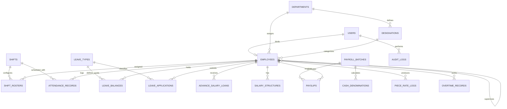
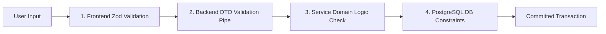
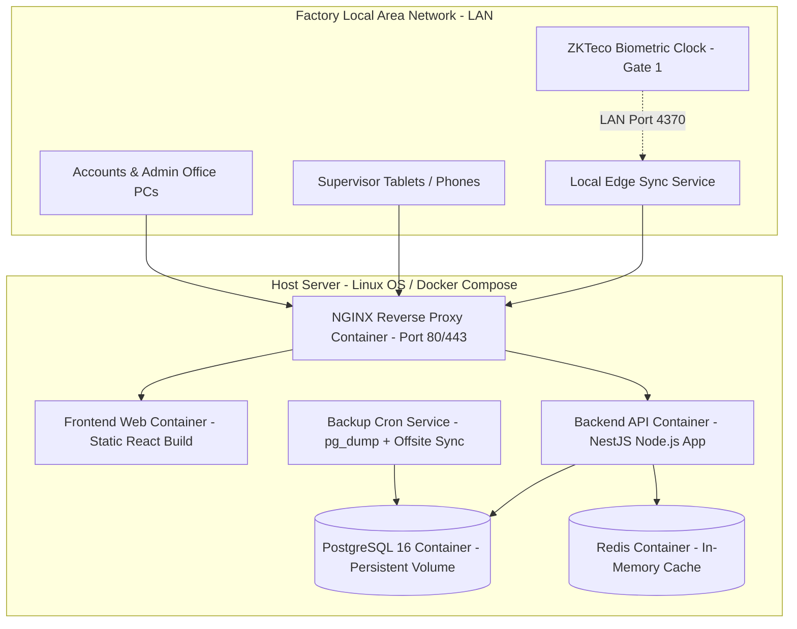

# Factory Management System (FMS)
## Technical Architecture & Database Design Specification
**Document Version:** 1.0.0-FINAL  
**Target Enterprise:** Medium-Sized Garment Manufacturing Facility (~100 Employees)  
**Deployment Context:** Industrial Floor & Office LAN (Pakistan)  
**Document Status:** Architecture Baseline  
**Parent Specifications:**  
- [`FACTORY_MANAGEMENT_SYSTEM_BRD_SRS.md`](file:///e:/Projects/Factory%20Managemenny%20System/docs/FACTORY_MANAGEMENT_SYSTEM_BRD_SRS.md)  
- [`FUNCTIONAL_REQUIREMENTS_SPECIFICATION.md`](file:///e:/Projects/Factory%20Managemenny%20System/docs/FUNCTIONAL_REQUIREMENTS_SPECIFICATION.md)  

---

## Table of Contents
1. [Architectural Principles & Project Status](#1-architectural-principles--project-status)
2. [Recommended Technology Stack & Justification](#2-recommended-technology-stack--justification)
3. [System Architecture (Frontend, Backend, Database & Edge)](#3-system-architecture-frontend-backend-database--edge)
4. [Relational Database Design & Data Dictionary](#4-relational-database-design--data-dictionary)
5. [Primary Keys, Foreign Keys & Referential Integrity](#5-primary-keys-foreign-keys--referential-integrity)
6. [Authentication, Authorization & Role-Based Access Control](#6-authentication-authorization--role-based-access-control)
7. [System Communication Protocols & API Standards](#7-system-communication-protocols--api-standards)
8. [Data Validation, Edge Cases & Error Handling Pipeline](#8-data-validation-edge-cases--error-handling-pipeline)
9. [Security, Field-Level Encryption & Backup Architecture](#9-security-field-level-encryption--backup-architecture)
10. [Practical Deployment Topology](#10-practical-deployment-topology)
11. [Traceability Matrix: Implemented vs. Pending Implementation](#11-traceability-matrix-implemented-vs-pending-implementation)

---

## 1. Architectural Principles & Project Status

### 1.1 Project Status & Greenfield Baseline
* **Current State:** The repository currently houses formal Business Requirements ([BRD/SRS](file:///e:/Projects/Factory%20Managemenny%20System/docs/FACTORY_MANAGEMENT_SYSTEM_BRD_SRS.md)) and the [Functional Requirements Specification](file:///e:/Projects/Factory%20Managemenny%20System/docs/FUNCTIONAL_REQUIREMENTS_SPECIFICATION.md). 
* **Zero Legacy Debt:** No application source code or framework configuration files exist in the project yet. This allows us to establish a clean, production-grade architectural baseline without backwards-compatibility encumbrances.

### 1.2 Core Architectural Principles for a 100-Worker Factory
1. **Pragmatic Monolith over Distributed Microservices:** With ~100 employees, distributed microservices introduce unnecessary operational latency, network serialization overhead, and deployment complexity. A well-structured **Modular Monolith** provides clean bounded contexts, transaction atomicity, and single-command local deployment.
2. **Local Edge Resilience:** The system must function reliably despite frequent industrial power fluctuations (load shedding) and external internet dropouts typical of Pakistani industrial zones.
3. **Strict ACID Guarantees:** Attendance normalization, salary advance (*Peshgi*) balances, and payroll calculations must execute with complete transactional isolation to eliminate race conditions and financial discrepancies.
4. **Low Operational Overhead:** The software must run efficiently on cost-effective infrastructure (such as an on-premise industrial mini-server or a modest 2 vCPU cloud virtual server) without requiring a full-time DevOps engineer.

---

## 2. Recommended Technology Stack & Justification

To ensure high performance, maintainability, type safety, and ease of hiring in the local market, the following stack is recommended:

```
┌────────────────────────────────────────────────────────────────────────┐
│                        RECOMMENDED TECH STACK                          │
├─────────────────┬──────────────────────────────────────────────────────┤
│ Frontend Tier   │ React (Vite) + TypeScript + Tailwind CSS             │
│                 │ Shadcn UI + TanStack Query (React Query)             │
├─────────────────┼──────────────────────────────────────────────────────┤
│ Backend Tier    │ Node.js (v20+ LTS) with NestJS (or Fastify) + TS     │
│                 │ Prisma ORM / Drizzle ORM (Type-Safe Data Access)     │
├─────────────────┼──────────────────────────────────────────────────────┤
│ Database Tier   │ PostgreSQL 16 (Relational Core + JSONB)               │
├─────────────────┼──────────────────────────────────────────────────────┤
│ Cache & Queue   │ Redis (Standalone) for Locks & Rate Limiting         │
├─────────────────┼──────────────────────────────────────────────────────┤
│ Edge Ingestion  │ Python/Node.js Standalone Daemon for ZKTeco LAN sync │
├─────────────────┼──────────────────────────────────────────────────────┤
│ Deployment      │ Docker Compose + NGINX Reverse Proxy + Let's Encrypt │
└─────────────────┴──────────────────────────────────────────────────────┘
```

### 2.1 Technology Choices & Rationale

* **Frontend: React (TypeScript) + Vite + Tailwind CSS + TanStack Query**
  - *Why:* Vite provides instant development builds and a lightweight production bundle. React is the industry standard with massive community support. Tailwind CSS enables responsive, high-contrast UI tailored for factory supervisors using low-cost tablets on the production floor.
  - *State & Cache:* TanStack Query delivers automatic caching, background polling, and optimistic UI updates for live floor boards.
* **Backend: Node.js with NestJS (or Express/Fastify with TypeScript)**
  - *Why:* NestJS provides a mature, enterprise-grade architecture out of the box (Dependency Injection, Controllers, Services, Guards, Pipes, and DTOs). Sharing TypeScript between frontend and backend minimizes contract drift and accelerates development.
  - *Alternative Considered (Python / FastAPI):* FastAPI is excellent for pure APIs, but NestJS offers a more rigid architectural structure for multi-module business software (Authentication, HR, Shifts, Attendance, Leaves, Payroll, Peshgi, Overtime, Reporting).
* **Database: PostgreSQL 16**
  - *Why:* PostgreSQL is the gold standard for relational integrity, robust datetime/timezone functions (critical for overnight shifts crossing midnight), strict foreign key cascades, and high-performance `JSONB` storage for itemized payslips and audit trails.
* **ORM: Prisma ORM (or Drizzle ORM)**
  - *Why:* Delivers compile-time type safety, automated migration management, and auto-generated TypeScript query clients that prevent SQL injection and schema drift.
* **Cache & Mutex: Redis (Standalone)**
  - *Why:* Used strictly for distributed mutex locking (preventing simultaneous payroll batch calculation) and rate-limiting authentication attempts.
* **Edge Biometric Relay: Lightweight Local Sync Service**
  - *Why:* Physical biometric terminals (e.g., ZKTeco K40, F18) communicate over local UDP/TCP port 4370. A lightweight local sync daemon on the factory LAN reads device punch buffers and posts them securely via HTTPS webhooks to the main backend API.

---

## 3. System Architecture (Frontend, Backend, Database & Edge)

The application follows a **Layered Modular Monolith** architecture with clean separation of concerns:

```mermaid
graph TB
    subgraph Client Tier - Browsers & Tablets
        FA_UI[Factory Admin Web Portal]
        SUP_UI[Supervisor Tablet Web UI]
        ACC_UI[Accountant Finance UI]
        EMP_UI[Employee Self-Service / Kiosk]
    end

    subgraph Hardware & Edge Layer
        BioDevice[ZKTeco Biometric Clock - Gate 1]
        EdgeSync[Local Edge Punch Sync Daemon]
        BioDevice -. Local TCP/IP Port 4370 .-> EdgeSync
    end

    subgraph Gateway & Security Tier
        NGINX[NGINX Reverse Proxy - TLS 1.3 Termination]
        WAF_Rate[Rate Limiting & IP Throttle]
    end

    subgraph Backend Core Application - NestJS Modular Monolith
        AuthModule[Auth & User Module]
        EmpModule[Employee Master Module]
        OrgModule[Dept & Designation Module]
        AttModule[Attendance & Shift Engine]
        LeaveModule[Leave Management Module]
        PayModule[Payroll & Peshgi Ledger]
        RepModule[Reporting & Statutory Module]
        AuditModule[Audit Logger Module]
    end

    subgraph Data & Persistence Tier
        Postgres[(PostgreSQL 16 Primary DB)]
        RedisCache[(Redis - Mutex Locks & Sessions)]
        LocalBackup[(Encrypted Daily Backup Volume)]
    end

    FA_UI & SUP_UI & ACC_UI & EMP_UI --> NGINX
    EdgeSync -. HTTPS Webhook .-> NGINX
    NGINX --> WAF_Rate --> AuthModule
    
    AuthModule --> EmpModule
    EmpModule --> OrgModule
    AttModule --> EmpModule
    LeaveModule --> AttModule
    PayModule --> AttModule
    PayModule --> LeaveModule
    RepModule --> PayModule
    AuditModule -. Interceptor .-> Postgres

    Backend Core Application --> Postgres
    Backend Core Application --> RedisCache
    Postgres -. Automated pg_dump .-> LocalBackup
```

### 3.1 Backend Internal Layering
Every backend module is partitioned into four strict internal layers:
1. **Controller / Route Layer:** Handles HTTP requests, deserializes inputs, enforces authentication guards, and validates request DTOs via class-validator/Zod.
2. **Service / Domain Layer:** Encapsulates core business rules (e.g., late grace periods, overtime multipliers, EOBI calculation, advance recovery caps).
3. **Repository / Data Access Layer:** Interfaces with PostgreSQL using Prisma/Drizzle type-safe queries.
4. **DTO & Event Layer:** Defines strongly-typed inputs, outputs, and internal event emitters (e.g., `EmployeeTerminatedEvent`, `AttendanceLockedEvent`).

---

## 4. Relational Database Design & Data Dictionary

The database schema is designed in **Third Normal Form (3NF)** with selective denormalization in reporting and immutable itemized payslips.



### 4.1 Master Table Specifications

#### Table 1: `users` (Authentication & Credentials)
* `id` (UUID, PK, Default: `gen_random_uuid()`)
* `employee_id` (UUID, Unique, Nullable, FK -> `employees.id`)
* `username` (VARCHAR(50), Unique, Not Null)
* `email` (VARCHAR(120), Unique, Nullable)
* `password_hash` (VARCHAR(255), Not Null) — Argon2id salted hash
* `role` (VARCHAR(30), Not Null) — `SUPER_ADMIN`, `FACTORY_ADMIN`, `SUPERVISOR`, `ACCOUNTANT`, `EMPLOYEE`
* `status` (VARCHAR(20), Default: `'ACTIVE'`) — `ACTIVE`, `INACTIVE`, `LOCKED`
* `failed_login_count` (INTEGER, Default: 0)
* `last_login_at` (TIMESTAMPTZ, Nullable)
* `mfa_secret` (VARCHAR(128), Nullable)
* `mfa_enabled` (BOOLEAN, Default: FALSE)
* `created_at`, `updated_at` (TIMESTAMPTZ, Default: `NOW()`)

#### Table 2: `departments` (Organizational Hierarchy)
* `id` (UUID, PK)
* `dept_code` (VARCHAR(20), Unique, Not Null) — e.g., `DEPT-STITCH-01`
* `dept_name` (VARCHAR(100), Not Null) — e.g., `Stitching Floor - Line 1`
* `cost_center_code` (VARCHAR(50), Not Null)
* `parent_dept_id` (UUID, Nullable, FK -> `departments.id`)
* `head_employee_id` (UUID, Nullable, FK -> `employees.id`)
* `is_production_unit` (BOOLEAN, Default: TRUE)
* `is_active` (BOOLEAN, Default: TRUE)
* `created_at`, `updated_at` (TIMESTAMPTZ)

#### Table 3: `designations` (Job Titles & Wage Bands)
* `id` (UUID, PK)
* `dept_id` (UUID, Not Null, FK -> `departments.id`)
* `designation_code` (VARCHAR(20), Unique, Not Null) — e.g., `DESIG-OVR-SK`
* `title` (VARCHAR(100), Not Null) — e.g., `Senior Overlock Stitcher`
* `skill_grade` (VARCHAR(30), Not Null) — `UNSKILLED`, `SEMI_SKILLED`, `SKILLED`, `HIGHLY_SKILLED`, `SUPERVISORY`, `EXECUTIVE`
* `min_base_salary` (DECIMAL(12,2), Not Null)
* `max_base_salary` (DECIMAL(12,2), Not Null)
* `is_active` (BOOLEAN, Default: TRUE)
* `created_at`, `updated_at` (TIMESTAMPTZ)

#### Table 4: `employees` (Personnel Master Record)
* `id` (UUID, PK)
* `employee_code` (VARCHAR(30), Unique, Not Null) — e.g., `GAR-0102`
* `biometric_device_user_id` (VARCHAR(30), Unique, Nullable) — Hardware pin ID
* `first_name` (VARCHAR(60), Not Null)
* `last_name` (VARCHAR(60), Not Null) — Surname / Father's Name
* `cnic_number` (VARCHAR(15), Unique, Not Null) — Formatted `XXXXX-XXXXXXX-X`
* `cnic_expiry_date` (DATE, Not Null)
* `date_of_birth` (DATE, Not Null)
* `gender` (VARCHAR(15), Not Null) — `MALE`, `FEMALE`, `TRANSGENDER`
* `contact_phone` (VARCHAR(20), Not Null)
* `emergency_contact_phone` (VARCHAR(20), Not Null)
* `employment_type` (VARCHAR(20), Not Null) — `PERMANENT`, `PROBATION`, `CONTRACT`, `DAILY_WAGE`, `PIECE_RATE`
* `status` (VARCHAR(20), Default: `'ACTIVE'`) — `ACTIVE`, `PROBATION`, `SUSPENDED`, `NOTICE_PERIOD`, `TERMINATED`, `RESIGNED`
* `hire_date` (DATE, Not Null)
* `department_id` (UUID, Not Null, FK -> `departments.id`)
* `designation_id` (UUID, Not Null, FK -> `designations.id`)
* `supervisor_id` (UUID, Nullable, FK -> `employees.id`)
* `payment_mode` (VARCHAR(20), Not Null) — `CASH`, `BANK_TRANSFER`, `EASYPAISA`, `JAZZCASH`
* `bank_iban` (VARCHAR(24), Nullable) — 24-character PK IBAN
* `mobile_wallet_number` (VARCHAR(15), Nullable)
* `eobi_number` (VARCHAR(30), Nullable)
* `sessi_pessi_number` (VARCHAR(30), Nullable)
* `created_at`, `updated_at` (TIMESTAMPTZ)

#### Table 5: `shifts` (Operational Shift Templates)
* `id` (UUID, PK)
* `shift_code` (VARCHAR(20), Unique, Not Null) — e.g., `SHIFT-GEN-DAY`
* `shift_name` (VARCHAR(60), Not Null)
* `start_time` (TIME, Not Null) — e.g., `08:00:00`
* `end_time` (TIME, Not Null) — e.g., `17:00:00`
* `is_overnight` (BOOLEAN, Default: FALSE)
* `late_grace_minutes` (INTEGER, Default: 15)
* `standard_break_minutes` (INTEGER, Default: 60)
* `friday_break_minutes` (INTEGER, Default: 120) — Extended Jumma prayer break
* `half_day_hours` (DECIMAL(4,2), Default: 4.00)
* `full_day_hours` (DECIMAL(4,2), Default: 8.00)
* `is_active` (BOOLEAN, Default: TRUE)

#### Table 6: `shift_rosters` (Worker Shift Schedules)
* `id` (UUID, PK)
* `employee_id` (UUID, Not Null, FK -> `employees.id`)
* `shift_id` (UUID, Not Null, FK -> `shifts.id`)
* `effective_date` (DATE, Not Null)
* `created_at` (TIMESTAMPTZ)
* *Constraint:* Unique composite index on `(employee_id, effective_date)`.

#### Table 7: `attendance_records` (Normalized Timesheet)
* `id` (UUID, PK)
* `employee_id` (UUID, Not Null, FK -> `employees.id`)
* `shift_id` (UUID, Not Null, FK -> `shifts.id`)
* `work_date` (DATE, Not Null) — Operational date
* `check_in_time` (TIMESTAMPTZ, Nullable)
* `check_out_time` (TIMESTAMPTZ, Nullable)
* `raw_minutes` (INTEGER, Default: 0)
* `net_work_hours` (DECIMAL(5,2), Default: 0.00)
* `late_in_minutes` (INTEGER, Default: 0)
* `early_exit_minutes` (INTEGER, Default: 0)
* `status` (VARCHAR(20), Not Null) — `PRESENT`, `LATE`, `HALF_DAY`, `ABSENT`, `ON_LEAVE`, `HOLIDAY`
* `is_manual_override` (BOOLEAN, Default: FALSE)
* `override_by_id` (UUID, Nullable, FK -> `employees.id`)
* `override_approved_by` (UUID, Nullable, FK -> `employees.id`)
* `override_reason` (TEXT, Nullable)
* `is_locked` (BOOLEAN, Default: FALSE) — Locked when payroll closes
* *Constraint:* Unique composite on `(employee_id, work_date)`.

#### Table 8: `leave_types` & `leave_balances`
* **`leave_types`**:
  * `id` (UUID, PK)
  * `code` (VARCHAR(20), Unique, Not Null) — `CASUAL`, `ANNUAL_EARNED`, `SICK`, `MATERNITY`
  * `yearly_quota` (DECIMAL(4,1), Not Null)
  * `is_paid` (BOOLEAN, Default: TRUE)
  * `is_carry_forward` (BOOLEAN, Default: FALSE)
* **`leave_balances`**:
  * `id` (UUID, PK)
  * `employee_id` (UUID, Not Null, FK -> `employees.id`)
  * `leave_type_id` (UUID, Not Null, FK -> `leave_types.id`)
  * `fiscal_year` (INTEGER, Not Null) — e.g., 2026
  * `accrued_days` (DECIMAL(4,1), Not Null)
  * `consumed_days` (DECIMAL(4,1), Default: 0.0)
  * `balance_days` (DECIMAL(4,1), Not Null)
  * *Constraint:* Unique composite on `(employee_id, leave_type_id, fiscal_year)`.

#### Table 9: `leave_applications`
* `id` (UUID, PK)
* `employee_id` (UUID, Not Null, FK -> `employees.id`)
* `leave_type_id` (UUID, Not Null, FK -> `leave_types.id`)
* `start_date` (DATE, Not Null)
* `end_date` (DATE, Not Null)
* `total_leave_days` (DECIMAL(4,1), Not Null)
* `reason` (TEXT, Not Null)
* `medical_doc_url` (VARCHAR(255), Nullable)
* `status` (VARCHAR(30), Default: `'PENDING_SUPERVISOR'`) — `PENDING_SUPERVISOR`, `APPROVED_SUPERVISOR`, `APPROVED_FINAL`, `REJECTED`, `CANCELLED`
* `supervisor_id` (UUID, Nullable, FK -> `employees.id`)
* `supervisor_remarks` (TEXT, Nullable)
* `final_approved_by` (UUID, Nullable, FK -> `employees.id`)
* `created_at`, `updated_at` (TIMESTAMPTZ)

#### Table 10: `advance_salary_loans` (Peshgi Ledger)
* `id` (UUID, PK)
* `employee_id` (UUID, Not Null, FK -> `employees.id`)
* `loan_type` (VARCHAR(20), Not Null) — `MONTHLY_PESHGI`, `EMERGENCY_LOAN`, `EID_ADVANCE`
* `total_amount_pkr` (DECIMAL(10,2), Not Null)
* `monthly_installment_pkr` (DECIMAL(10,2), Not Null)
* `total_installments` (INTEGER, Not Null)
* `remaining_balance_pkr` (DECIMAL(10,2), Not Null)
* `status` (VARCHAR(20), Default: `'ACTIVE'`) — `PENDING_APPROVAL`, `ACTIVE`, `REPAID`, `WRITTEN_OFF`
* `approved_by_id` (UUID, Not Null, FK -> `employees.id`)
* `disbursed_at` (TIMESTAMPTZ, Nullable)
* `created_at` (TIMESTAMPTZ)

#### Table 11: `payroll_batches` & `payslips`
* **`payroll_batches`**:
  * `id` (UUID, PK)
  * `batch_code` (VARCHAR(50), Unique, Not Null) — e.g., `PAY-2026-NOV`
  * `period_start_date` (DATE, Not Null)
  * `period_end_date` (DATE, Not Null)
  * `total_gross_pkr` (DECIMAL(14,2), Default: 0.00)
  * `total_deductions_pkr` (DECIMAL(14,2), Default: 0.00)
  * `total_net_pkr` (DECIMAL(14,2), Default: 0.00)
  * `status` (VARCHAR(30), Default: `'DRAFT'`) — `DRAFT`, `CALCULATING`, `AWAITING_APPROVAL`, `APPROVED_LOCKED`, `DISBURSED`
  * `processed_by_id` (UUID, Not Null, FK -> `employees.id`)
  * `approved_by_id` (UUID, Nullable, FK -> `employees.id`)
  * `locked_at` (TIMESTAMPTZ, Nullable)
* **`payslips`**:
  * `id` (UUID, PK)
  * `payroll_batch_id` (UUID, Not Null, FK -> `payroll_batches.id`)
  * `employee_id` (UUID, Not Null, FK -> `employees.id`)
  * `wage_type` (VARCHAR(20), Not Null) — `MONTHLY_FIXED`, `DAILY_WAGE`, `PIECE_RATE`
  * `payable_days` (DECIMAL(4,1), Not Null)
  * `base_salary_earned` (DECIMAL(10,2), Not Null)
  * `allowances_total` (DECIMAL(10,2), Default: 0.00)
  * `overtime_pay` (DECIMAL(10,2), Default: 0.00)
  * `piece_rate_earnings` (DECIMAL(10,2), Default: 0.00)
  * `gross_pay` (DECIMAL(10,2), Not Null)
  * `peshgi_deduction` (DECIMAL(10,2), Default: 0.00)
  * `eobi_deduction` (DECIMAL(10,2), Default: 0.00)
  * `income_tax_deduction` (DECIMAL(10,2), Default: 0.00)
  * `other_deductions` (DECIMAL(10,2), Default: 0.00)
  * `total_deductions` (DECIMAL(10,2), Not Null)
  * `net_pay` (DECIMAL(10,2), Not Null)
  * `payment_mode` (VARCHAR(20), Not Null)
  * `payment_status` (VARCHAR(20), Default: `'UNPAID'`)
  * `itemized_breakdown_json` (JSONB, Not Null)
  * *Constraint:* Unique composite on `(payroll_batch_id, employee_id)`.

#### Table 12: `cash_denominations` (Physical Currency Withdrawal Breakdown)
* `id` (UUID, PK)
* `payroll_batch_id` (UUID, Unique, Not Null, FK -> `payroll_batches.id`)
* `note_5000_count` (INTEGER, Default: 0)
* `note_1000_count` (INTEGER, Default: 0)
* `note_500_count` (INTEGER, Default: 0)
* `note_100_count` (INTEGER, Default: 0)
* `note_50_count` (INTEGER, Default: 0)
* `note_20_count` (INTEGER, Default: 0)
* `note_10_count` (INTEGER, Default: 0)
* `total_cash_amount` (DECIMAL(14,2), Not Null)
* `calculated_at` (TIMESTAMPTZ, Default: `NOW()`)

#### Table 13: `audit_logs` (Immutable WORM Audit Trail)
* `id` (UUID, PK)
* `actor_user_id` (UUID, Nullable, FK -> `users.id`)
* `action` (VARCHAR(30), Not Null) — `CREATE`, `UPDATE`, `DELETE`, `OVERRIDE`, `APPROVE`, `LOGIN`, `EXPORT`
* `entity_type` (VARCHAR(50), Not Null) — e.g., `attendance_records`, `payslips`
* `entity_id` (UUID, Not Null)
* `old_state_json` (JSONB, Nullable)
* `new_state_json` (JSONB, Nullable)
* `ip_address` (INET, Not Null)
* `user_agent` (TEXT, Not Null)
* `timestamp` (TIMESTAMPTZ, Default: `NOW()`)
* *Database Rule:* Reject SQL `UPDATE` and `DELETE` at PostgreSQL trigger level.

---

## 5. Primary Keys, Foreign Keys & Referential Integrity

### 5.1 Key Design Decisions
* **UUIDv4 Primary Keys:** Every table utilizes Universally Unique Identifiers (UUIDv4) rather than sequential integers (`SERIAL`). This eliminates primary key enumeration vulnerabilities and enables clean client-side ID pre-generation when necessary.
* **Referential Integrity Constraints:**
  - Foreign keys default to `ON DELETE RESTRICT` for master tables (`departments`, `designations`, `employees`, `shifts`). A department or designation with linked employees **cannot be deleted**.
  - Child records linked to locked payroll batches default to `ON UPDATE NO ACTION / ON DELETE RESTRICT` to guarantee historical immutability.
* **Strategic Database Indexes:**
  - `idx_attendance_emp_date`: `CREATE INDEX ON attendance_records (employee_id, work_date);`
  - `idx_attendance_date_status`: `CREATE INDEX ON attendance_records (work_date, status);`
  - `idx_employees_cnic`: `CREATE UNIQUE INDEX ON employees (cnic_number);`
  - `idx_employees_status`: `CREATE INDEX ON employees (status);`
  - `idx_audit_entity_time`: `CREATE INDEX ON audit_logs (entity_type, timestamp DESC);`

---

## 6. Authentication, Authorization & Role-Based Access Control

### 6.1 Authentication Mechanism
```
[Client Web Browser] 
        │ (POST /api/v1/auth/login)
        ▼
[NestJS Auth Controller] 
        │ 1. Verify Argon2id password hash
        │ 2. Check failed_login_count (< 5)
        │ 3. If MFA enabled, verify TOTP code
        ▼
[JWT Token Dispatch] 
        ├──> Access Token (15-min life, returned in response payload)
        └──> Refresh Token (7-day life, HTTP-only, Secure, SameSite=Strict cookie)
```

### 6.2 Role-Based Guard Enforcement
Role validation is enforced at the backend controller level using declarative decorators:
* `@Roles('SUPER_ADMIN', 'FACTORY_ADMIN')`: Restricts system master configuration and global payroll lock.
* `@Roles('ACCOUNTANT')`: Grants exclusive access to salary structures, loan ledgers, and draft payroll calculation.
* `@Roles('SUPERVISOR')` + `@DepartmentScope()`: Grants access strictly to subordinates assigned to the supervisor's specific department/line.
* `@Roles('EMPLOYEE')`: Grants access strictly where `employee_id == session.user.employee_id`.

---

## 7. System Communication Protocols & API Standards

### 7.1 Protocol Architecture
* **Frontend to Backend:** RESTful JSON API communicating over HTTPS (TLS 1.3).
* **Edge Biometric Ingestion:** 
  - Standalone ZKTeco terminals on factory LAN stream punch events over UDP/TCP port 4370 to a local Python/Node.js edge daemon.
  - The edge daemon batches punches and executes an HTTPS `POST /api/v1/attendance/punch-ingest` webhook call to the backend with an authorized API secret key.
* **Backend to Database:** Persistent connection pooling via PostgreSQL client with parameter substitution to guarantee zero SQL injection.

### 7.2 Standard API Response Contract
All API endpoints adhere to a uniform JSON response envelope:

```json
// Success Response (HTTP 200 / 201)
{
  "success": true,
  "data": {
    "attendance_id": "9b1deb4d-3b7d-4bad-9bdd-2b0d7b3dcb6d",
    "status": "PRESENT",
    "net_work_hours": 8.00
  },
  "meta": {
    "timestamp": "2026-11-11T18:00:00Z"
  }
}

// Error Response (HTTP 4xx / 5xx)
{
  "success": false,
  "error": {
    "code": "VALIDATION_FAILED",
    "message": "Invalid CNIC format. Expected 13 digits: XXXXX-XXXXXXX-X",
    "details": [
      { "field": "cnic_number", "issue": "Regex pattern mismatch" }
    ]
  },
  "meta": {
    "timestamp": "2026-11-11T18:00:00Z"
  }
}
```

---

## 8. Data Validation, Edge Cases & Error Handling Pipeline

Validation is implemented defensively at three distinct boundaries:
1. **Frontend UI Boundary:** Reactive client-side validation using **Zod** and React Hook Form (instant user feedback before submission).
2. **Backend Controller Boundary:** Class-validator / Zod DTO schema validation intercepting incoming HTTP payloads before entering domain logic.
3. **Database Constraint Boundary:** PostgreSQL `CHECK` constraints, foreign keys, and unique indexes guaranteeing relational integrity.



### 8.1 Key Industrial Edge Cases Handled

| Edge Case | Failure Mode / Business Risk | System Mitigation Architecture |
| :--- | :--- | :--- |
| **Overnight Shift Crossing Midnight** | Check-in at 21:50 on Monday, check-out at 06:10 on Tuesday registers as two broken daily attendance records. | Attendance engine evaluates `shifts.is_overnight = true`. Both punches are automatically windowed and attributed to Monday's operational `work_date`. |
| **Biometric Bounce (Multi-tap)** | Worker presses fingerprint 3 times within 15 seconds, creating duplicate entries. | Anti-passback debounce filter: Pushes within 180 seconds for the same user ID are discarded at the edge ingestion queue. |
| **Simultaneous Payroll Calculation Race** | Two accountants trigger payroll computation at the same time, producing corrupted totals. | Distributed Mutex Lock: Backend acquires a Redis lock (`payroll:lock:batch_id`) before running calculations. Subsequent requests immediately return HTTP `423 Locked`. |
| **Peshgi Exceeding Net Pay** | Worker takes heavy advance loan; deductions exceed total gross pay. | Guardrail check: Advance deductions are capped at 50% of monthly gross wages; remaining balance rolls over to the next month's loan ledger. |
| **Load Shedding / Power Outage** | Factory electricity drops during shift exit; network goes down. | Standalone biometric terminals operate on internal DC battery, logging punches to local device flash memory. When power/LAN restores, edge daemon replays logs idempotently. |

---

## 9. Security, Field-Level Encryption & Backup Architecture

### 9.1 Data Protection & Privacy
* **Sensitive Field Encryption:** CNIC numbers and bank IBANs are encrypted at rest in PostgreSQL using AES-256 envelope encryption.
* **Password Hashing:** Argon2id with unique cryptographic salts per user.
* **Rate Limiting:** NGINX and Redis throttle API requests to 100 requests/minute per IP, with auth endpoints throttled to 5 requests/minute.

### 9.2 Practical Backup & Disaster Recovery (Pakistan Environment)
Given local load-shedding and potential hardware failures, the backup architecture is configured with a two-tier strategy:

1. **Daily Automated Local Snapshot:**
   - A scheduled cron container runs `pg_dump -Fc` every night at 02:00 AM, writing a compressed, encrypted snapshot to an independent physical drive / local NAS volume.
   - Retained locally for 14 days.
2. **Offsite Encrypted Replication:**
   - Following successful local creation, the dump is encrypted via GPG (`AES-256`) and synchronized to offsite secure cloud object storage (e.g., AWS S3 or Wasabi) using `rclone`.
   - **RPO:** $\le 24\text{ hours}$ (Daily snapshot) + continuous Write-Ahead Log (WAL) archiving.
   - **RTO:** $\le 45\text{ minutes}$ (Fast restore from local snapshot container).

---

## 10. Practical Deployment Topology

The system is architected for deployment on an **on-premise local server** (such as an Intel Core i5 / 16GB RAM industrial mini-PC connected to an uninterrupted power supply / UPS) or a **cost-effective Cloud VPS** (2 vCPU, 4GB RAM) running Docker Compose:



### 10.1 `docker-compose.yml` Architecture Blueprint
* `nginx`: Serves compiled React static assets, terminates SSL, and proxies `/api/*` to the backend.
* `api`: Single Node.js container running the NestJS modular monolith.
* `postgres`: PostgreSQL 16 Alpine container with a host-mounted data volume (`/var/lib/postgresql/data`).
* `redis`: Redis Alpine container configured with maxmemory limits.
* `backup`: Alpine cron container executing scheduled backup scripts.

---

## 11. Traceability Matrix: Implemented vs. Pending Implementation

To maintain engineering transparency, this matrix maps the architecture against project components:

| Architectural Component | Documented / Specified Status | Codebase Implementation Status | Target Phase |
| :--- | :--- | :--- | :--- |
| **Business Requirements (BRD & SRS)** | **Completed** ([`BRD_SRS.md`](file:///e:/Projects/Factory%20Managemenny%20System/docs/FACTORY_MANAGEMENT_SYSTEM_BRD_SRS.md)) | Baseline Documentation | Phase 0 |
| **Functional Specifications (12 Modules)** | **Completed** ([`FRS.md`](file:///e:/Projects/Factory%20Managemenny%20System/docs/FUNCTIONAL_REQUIREMENTS_SPECIFICATION.md)) | Baseline Documentation | Phase 0 |
| **Technical & Database Architecture** | **Completed** (This Document) | Baseline Documentation | Phase 0 |
| **Database Schema Migrations (Prisma)** | Fully Designed in Section 4 | *Pending Implementation* | Phase 1 |
| **Backend Core Framework & Auth (NestJS)** | Fully Designed in Section 3 & 6 | *Pending Implementation* | Phase 1 |
| **Employee, Dept & Designation APIs** | Fully Designed in Section 4 & 7 | *Pending Implementation* | Phase 2 |
| **Shift & Attendance Normalization Engine** | Fully Designed in Section 4 & 8 | *Pending Implementation* | Phase 2 |
| **Biometric LAN Edge Sync Daemon** | Fully Designed in Section 3 & 7 | *Pending Implementation* | Phase 2 |
| **Leave Management & Approval Flow** | Fully Designed in Section 4 & 6 | *Pending Implementation* | Phase 3 |
| **Payroll, Peshgi Ledger & Denominations** | Fully Designed in Section 4 & 8 | *Pending Implementation* | Phase 3 |
| **Frontend UI Screens (React + Tailwind)** | Fully Designed in Section 2 & 3 | *Pending Implementation* | Phase 4 |
| **Docker Compose & Deployment Scripts** | Fully Designed in Section 10 | *Pending Implementation* | Phase 5 |

---

## Architectural Sign-off & Verification

```
Prepared By: ___________________________ (Lead Systems Architect & Senior BA)
Reviewed By: ___________________________ (Lead Software Engineer)
Approved By: ___________________________ (Factory Operations & IT Director)
Date:        ___________________________
```
